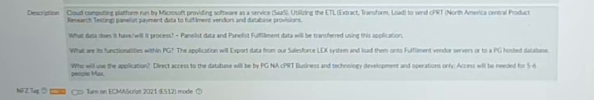

# Application Mission Pack - North America Central Product Research Testing Panelist Payments

- **Version:** 1
- **Knowledge state:** PARTIAL - source session AMS_KAP_-_App_Support_-_Session_41; source coverage is incomplete
- **Provenance:** Session 41 only. No other source session for this application was found in the local transcription/document corpus. Duplicate transcript exports share one source-video hash and count as one session.

## Executive Brief

- Session 41 provides limited business/lifecycle context and a captured application-catalogue description. It does not provide the promised technical walkthrough. [C-016, C-019, C-024]
- The catalogue screen suggests an ETL path for panelist-payment and fulfilment data; validate the source and destinations with the technical owner before operating it. [C-016, C-017]

## Business Purpose

- The application is named North America Central Product Research Testing Panelist Payments. Its record describes panelist data and fulfilment data being transferred, and Salesforce LEX exports loaded to fulfilment vendor servers or a P&G-hosted database. These details are from the captured catalogue screen, not a completed technical walkthrough. [C-001, C-016, C-017]

## Support Scope

- The catalogue lists P&G AMS Support Team; it describes direct database access for PG NA CPRT business, technology development, and operations, with about five to six people at most. [C-018]
- Support boundary across SaaS provider, ETL, vendor servers, and P&G-hosted database is not fully established. [C-016, C-017]

## Users and Roles

- The catalogue description identifies PG NA CPRT business, technology development, and operations as direct database users; access expected for five to six people at most. [C-018]
- The recording does not name individual approvers or provide a role matrix. [C-018]

## Operational Data Flow

- Captured record: Salesforce LEX data is exported and loaded to fulfilment vendor servers or a P&G-hosted database; panelist and fulfilment data are transferred using the application. [C-016, C-017]
- No file formats, schedules, validation rules, retry/error paths, reconciliation, or manual operation steps are described. [C-017]

## Technical Architecture

- The captured catalogue description calls this a Microsoft-run cloud/SaaS platform using ETL. No specific Microsoft service, Azure subscription/resource, environment, network boundary, database engine, or integration implementation is confirmed. [C-016, C-017]
- The speaker says code/scripts are stored in a location transcribed as 'data floor'; its exact name and URL/repository are unverified. [C-022]

## Access and Authentication

- A presenter reports lacking permission to the Azure resource group. A participant says to try an AMS Admin identity; the recording does not show whether that worked. [C-023]
- The catalogue says direct database access is limited to named business/technology/operations functions and approximately five to six people. No credential or identity provider is stated. [C-018]

## Ownership and Contacts

- P&G AMS Support Team appears in the catalogue screenshot. The individual owner field is too soft to transcribe reliably and is omitted. Business and technical owners are not confirmed. [C-018, V-004]

## Application Lifecycle

- The speaker reports a move from sunset to leverage optimized because decommissioning had not been decided. The captured record displays Leverage/Optimize. [C-019]
- Limited usage is based on ticket history; limited users are described as the speaker's impression. Possible future decommissioning is expected, not approved. [C-020, C-021]

## Support Operations

- The application is associated with limited ticket usage and possible future decommission requests. The recording gives no ticket queue, on-call model, monitoring, reconciliation, support schedule, or recurring operator checklist. [C-020, C-021]

## Troubleshooting Knowledge

- Observed access issue: presenter lacked Azure resource-group permission. The suggested AMS Admin identity was not shown to resolve it. No validated resolution path is available. [C-023]

## Procedures / SOP

- No operational procedure is supported. Do not turn the access attempt or unverified ETL description into runbook steps. [C-017, C-023, C-024]

## Known Risks and Limitations

- Lifecycle decision remains undecided; low usage/user claims are partly impression-based; source ends before the video; the ETL description is only a captured catalogue record. [C-019, C-020, E-024]
- The phrase 'transition to corruption mining' is suspicious and unresolved. Do not publish it as a lifecycle activity. [C-025]

## Deferred / Missing Knowledge

- Verified service/repository name, code location, access group, actual architecture, ETL jobs, source/target schemas, vendor list, monitoring, failure handling, ownership, ticket statistics, lifecycle decision, and technical walkthrough are missing. [C-022, C-023, C-024]

## Open Questions

- What is the verified platform/repository name transcribed as 'data floor', and where are its scripts/code?
- Which Azure resource group and approved AMS Admin role are required, and who grants them?
- Which Microsoft SaaS/ETL service is used, and what are its environments and operating owner?
- Confirm the Salesforce LEX extract, panelist/fulfilment data fields, destinations, schedules, and failure handling shown in the catalogue record.
- Confirm which fulfillment vendors and P&G-hosted databases are current destinations.
- Who are the application, business, technical, support, and decommissioning decision owners?
- What ticket counts, user counts, operational load, and last-use evidence support the lifecycle decision?
- Is decommissioning planned, approved, funded, or only a possible future request?
- What did 'transition to corruption mining' mean? No interpretation is supported by this recording.
- What exact technical session and application-access demonstration were deferred?
- Which named individuals should be contacted? The screenshot owner text is too soft to record reliably.

## Action Items / Follow-ups

- Schedule the deferred technical walkthrough; arrange approved resource-group access and confirm the correct AMS Admin role through the normal access process. [C-023, C-024]
- Locate and verify the code/scripts repository, dataflows, destinations, ticket/user evidence, and lifecycle decision owner. [C-017, C-020, C-021, C-022]
- Ask the speaker to clarify 'transition to corruption mining'; do not guess its meaning. [C-025]

## Ambiguities / Needs Review

- 'Data floor' could not be verified as a platform/repository name. No interpretation is supported. [C-022]
- 'Transition to corruption mining' has no supported interpretation in the source. [C-025]

## Glossary

- ETL: Extract, Transform, Load; this expansion appears in the captured application-catalogue description. [C-016]
- SaaS: software as a service; this expansion appears in the captured application-catalogue description. [C-016]
- 'Data floor' is not included as a verified glossary term. [C-022]

## Evidence Timeline

See the session-level `evidence-timeline.json`; application evidence IDs are listed below.

- `C-016` 00:20:51 - The application catalogue screen describes a Microsoft-run SaaS/ETL platform for North America CPRT panelist payment data and fulfilment data.
- `C-017` 00:20:51 - The catalogue description says Salesforce LEX data is exported and loaded to fulfilment vendor servers or a P&G-hosted database.
- `C-018` 00:20:51 - The catalogue description limits direct database access to PG NA CPRT business, technology development, and operations, with access needed for about five to six people at most.
- `C-019` 00:18:23 - The catalogue record shows lifecycle status Leverage/Optimize; the speaker says it moved from sunset to leverage optimized while decommissioning remained undecided.
- `C-020` 00:20:34 - Limited usage is reported from ticket history, and limited user count is explicitly presented as the speaker's impression.
- `C-021` 00:20:38 - Future requests for full decommissioning are expected; the recording does not say decommissioning was approved.
- `C-022` 00:15:20 - The speaker says code/scripts are stored in a place transcribed as 'data floor'; the proper platform name and location are not verified.
- `C-023` 00:12:10 - The presenter reports lacking permission to the application's Azure resource group; another participant advises trying an AMS Admin identity, but successful access is not shown.
- `C-024` 00:15:20 - The planned technical walkthrough was deferred; the presenter lacked preparation and access to resources/code.
- `C-025` 00:20:51 - The phrase 'transition to corruption mining' appears in the transcript during lifecycle discussion and cannot be safely interpreted from the available evidence.

## Source Map

See the session-level source map in `evidence-timeline.json`; evidence references are limited to Session 41 source media, transcript segments and sampled video frames.
