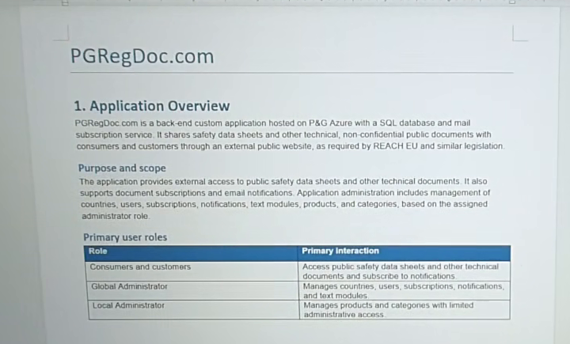
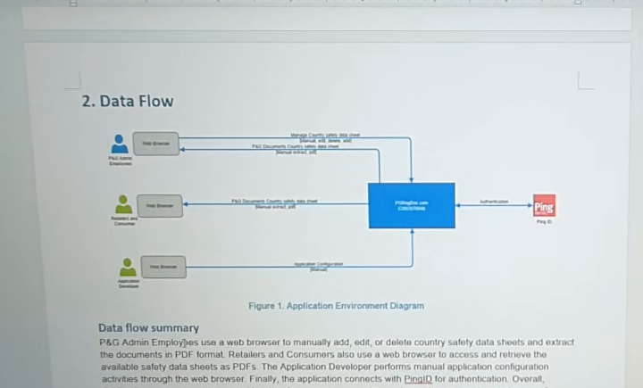
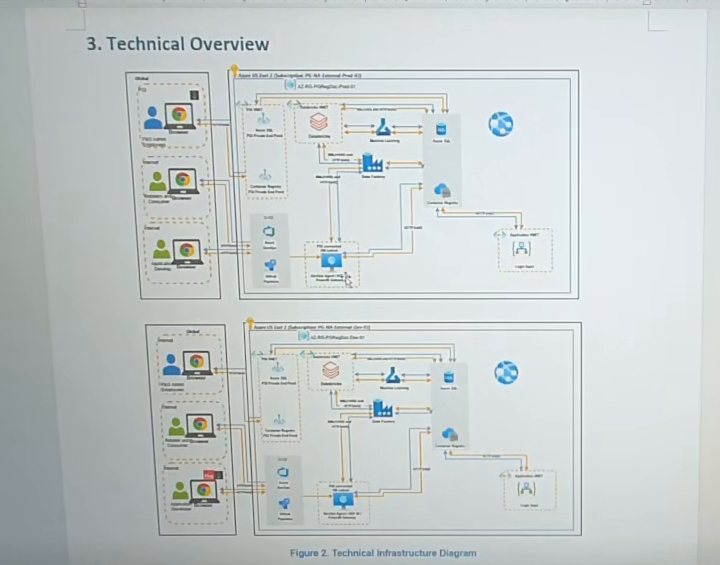

# Application Mission Pack - pgregdoc.com

- **Version:** 1
- **Knowledge state:** PARTIAL - source session AMS_KAP_-_App_Support_-_Session_41; source coverage is incomplete
- **Provenance:** Session 41 only. No other source session for this application was found in the local transcription/document corpus. Duplicate transcript exports share one source-video hash and count as one session.

## Executive Brief

- PG RegDoc is described as a custom backend supporting a public document portal for safety data sheets (SDS) and other non-confidential technical documents. [C-002, C-003]
- This session covers its business overview but not the promised technical deep-dive. Treat architecture and access details as a starting evidence set, not an operational runbook. [C-011, C-015]

## Business Purpose

- Provide external access to public SDS and technical documents for customers/consumers; subscriptions and email updates are also described. [C-003, C-006]
- REACH is mentioned as a related business requirement. The speaker explicitly disclaims familiarity with REACH; the informal 'regulations' gloss is not a verified definition. [C-004, C-005]

## Support Scope

- In scope: support for the public website because the team supports the backend application that serves it. [C-008]
- Frontend ownership, external site infrastructure, and explicit out-of-scope components are not specified. Do not infer a separate frontend team or exclusion. [C-008]

## Users and Roles

- Consumers/customers access public documents and subscribe to notifications. Global administrators manage countries, subscriptions, notifications/text modules; local administrators manage products/categories. [C-006, C-007]
- Administrative capabilities depend on the assigned role. [C-007]

## Operational Data Flow

- Admin employees manually add, edit, and delete country-specific SDS and extract documents as PDF. Consumers retrieve available SDS PDFs through a browser. Developers use the application for manual configuration. [C-009, C-010]
- The transcript does not define the email delivery path or where subscription state is stored. [C-002, C-006]

## Technical Architecture

- Evidence names P&G Azure, separate production/development environments, SQL/Azure SQL storage, Azure Data Factory processing, private endpoints, and virtual networks. [C-002, C-011]
- The slide shows a technical infrastructure diagram, but component labels and detailed flows are not readable enough to establish specific service instances, topology, deployment pipeline, or network rules. [V-003]
- The mail subscription service is named but its implementation and relationship to SQL/Data Factory are unresolved. [C-002]

## Access and Authentication

- Public consumer access and role-based administrator access are described; users are said to be managed through IT Access. [C-007, C-013]
- The flow diagram labels PingID; transcript exports render the spoken provider phrase differently. Confirm the current identity configuration before operational use. [C-013]

## Ownership and Contacts

- The reference overview names Miguel Angel Moreno-Fernandez as owner; this is evidenced in the transcript and slide. [C-012]
- A presenter called Muchun was expected to provide technical detail but said they were not prepared and lacked access. This does not establish technical ownership. [C-015]

## Application Lifecycle

- No lifecycle status, decommissioning plan, or lifecycle decision is established for PG RegDoc in this recording. [E-009, E-012]
- A speaker says the app is not fully developed and begins an 'open source' statement, but the sentence is incomplete and needs clarification. [C-014]

## Support Operations

- Recurring evidenced work is manual country-specific SDS maintenance, role-based product/category/country administration, subscription/notification administration, PDF extraction, and manual developer configuration. [C-006, C-007, C-009, C-010]
- No monitoring, incident intake, patching cadence, release, restore, or ticket procedures are evidenced. [E-009, E-012]

## Troubleshooting Knowledge

- No application symptoms, diagnostic checks, or validated resolutions were demonstrated. The planned technical session was deferred. [C-015]
- Do not infer troubleshooting steps from the architecture slide. [V-003]

## Procedures / SOP

- No step-by-step support SOP is sufficiently evidenced. The transcript describes business activities, not an approved operational procedure. [C-009, C-010]

## Known Risks and Limitations

- The recording is source-incomplete, ending 11m09s before video end; unrecorded technical detail may exist. [E-024]
- Technical deep-dive, mail integration, authentication provider, precise website support boundary, and application maturity remain unresolved. [C-008, C-013, C-014, C-015]

## Deferred / Missing Knowledge

- Detailed architecture, app components, Azure resource names, SQL model, Data Factory pipelines, private endpoint/VNet routes, monitoring, backup/restore, change/release, identity groups, support escalation, code location, and dependency ownership are missing. [V-003, C-015]

## Open Questions

- Which technical owner can provide the deferred architecture walkthrough and source/code ownership?
- Where does the mail subscription service run, and what triggers and sends email updates?
- Does Azure SQL initiate notifications, or is another service responsible?
- Which Azure resources, subscriptions, regions, deployment units, and production/development URLs are in scope?
- Which SQL databases/schemas and Data Factory pipelines are used, and what schedules/retries/alerts apply?
- Which private endpoints, VNets, DNS, firewall rules, and identity controls apply?
- What is the exact identity provider name? The transcript variants conflict ('being'/'spin solutions').
- Which IT Access group grants consumer, global-admin, local-admin, and developer permissions?
- What is the precise support boundary for the public frontend, backend, and external website?
- What are backup, restore, retention, monitoring, incident escalation, and change procedures?
- Is the application still under development, and what did the incomplete 'open source' statement mean?
- Which version of the app reference/classification/BIA record is current?

## Action Items / Follow-ups

- Schedule the deferred technical walkthrough with the application technical owner; confirm the presenter has approved access before the session. [C-015]
- Validate mail/notification implementation, authentication provider, IT Access groups, support boundary, and current classification/BIA record. [C-002, C-012, C-013]

## Ambiguities / Needs Review

- REACH definition is explicitly uncertain; preserve that as speaker uncertainty. [C-005]
- Resolve the authentication phrase conflict and the incomplete development/open-source statement. [C-013, C-014]

## Glossary

- SDS: safety data sheet. [C-003, C-009]
- Azure Data Factory: named in the source as supporting data processing. [C-011]
- Production and development: the two environments named in the source. [C-011]
- REACH is excluded as an unverified definition; the flow diagram labels PingID, while the spoken provider phrase remains ambiguous. [C-005, C-013]

## Evidence Timeline

See the session-level `evidence-timeline.json`; application evidence IDs are listed below.

- `C-002` 00:01:26 - PGRegDoc.com is described as a custom backend hosted on P&G Azure, using SQL and a mail subscription service.
- `C-003` 00:01:47 - The application shares public, non-confidential safety data sheets and technical documents with consumers and customers through an external website.
- `C-004` 00:01:42 - The speaker says this document-sharing capability supports business requirements associated with REACH.
- `C-005` 00:01:49 - The speaker says they are not familiar with REACH and offers 'regulations' as their own informal meaning; this definition is not independently confirmed.
- `C-006` 00:02:09 - The application supports subscriptions and email notifications for updates about available documentation.
- `C-007` 00:02:48 - Three user groups are described: consumers/customers, global administrators, and local administrators; global admins manage countries, subscriptions, notifications/text modules, while local admins manage products/categories.
- `C-008` 00:04:24 - The public website remains within support scope because its backend application is supported; the precise frontend ownership boundary is not stated.
- `C-009` 00:05:07 - Admin employees manually add, edit, and delete country-specific safety data sheets and extract documents as PDFs; consumers retrieve available PDFs.
- `C-010` 00:05:35 - Application developers use the browser to perform manual application configuration.
- `C-011` 00:05:53 - The application has production and development environments; Azure SQL is described as data storage, Azure Data Factory as processing, and private endpoints/virtual networks as network controls.
- `C-012` 00:06:40 - The application reference slide/transcript identifies owner Miguel Angel Moreno-Fernandez, public classification, and low overall BIA.
- `C-013` 00:05:41 - The application flow diagram labels PingID as the authentication dependency; IT Access is named for user management. The exact spoken provider phrase remains unclear.
- `C-014` 00:07:09 - The speaker says the application is not fully developed and starts describing an open-source intention, but the sentence is incomplete.
- `C-015` 00:08:00 - The technical deep-dive was deferred because the planned presenter said they were not prepared and lacked application/resource access.

## Source Map

See the session-level source map in `evidence-timeline.json`; evidence references are limited to Session 41 source media, transcript segments and sampled video frames.
